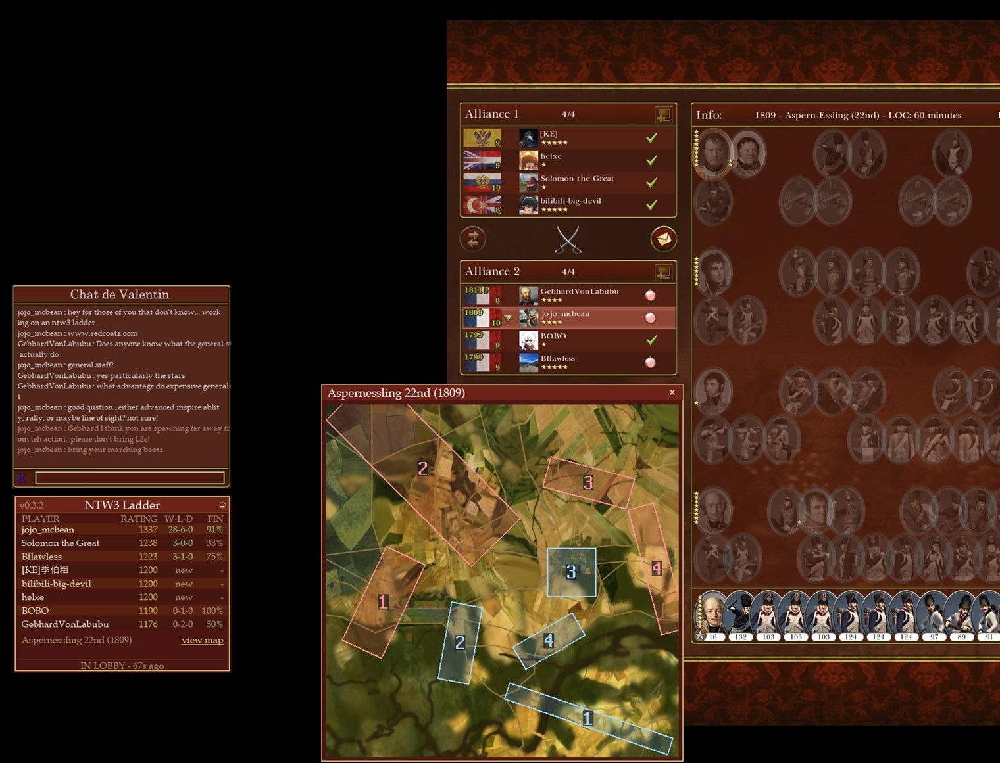
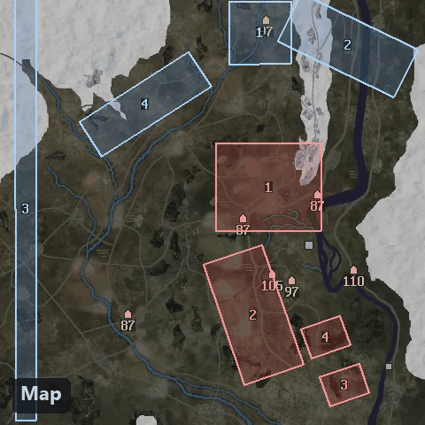
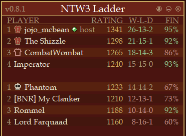
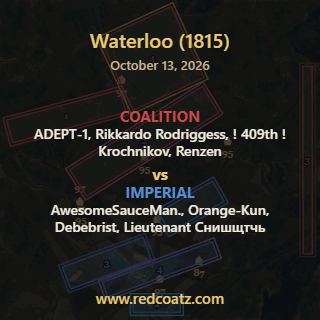
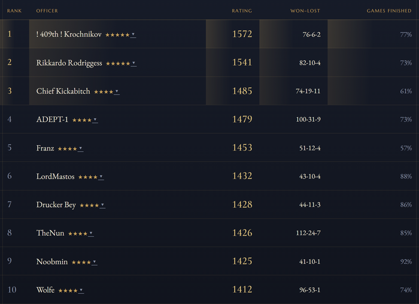

# Redcoatz

[Redcoatz](https://redcoatz.com) is a community project for NTW3 multiplayer,
making it more stable, more capable, and easier to join.

NTW3 is the Lordz Modding Collective's remaking of Napoleon: Total War, and
more than a decade on it is still the best large-scale Napoleonic battle game
there is: historical rosters, real formations, and a community that fights
3v3 and 4v4 battles every evening. Redcoatz exists because we love it and
wanted it to stop crashing, to be easier for a newcomer to walk into, and to
analyze battles.

## What Redcoatz gives you

* **No more sound crashes.** Redcoatz fixes a bug in the original game's sound
  engine.
* **No more 23e crashes.** Redcoatz fixes a bug in the NTW3 mod that caused
  crashes with the 23e army.
* **No more large artillery crashes.** Big battles used to crash to desktop
  when more than 100 units came within range of the heavy guns. Redcoatz
  found the cause and patches it while the game runs.
* **See the map and your spawn from the lobby.** Layout, relief, movement
  speed and both deployment zones for the map the host has chosen, with
  your own zone marked. The game's lobby loses track of positions when
  people leave and rejoin; Redcoatz reads the seat you are actually in.

  

* **Know who you are up against.** Every player's rating and record before a
  shot is fired, and how often they stay to the end of a battle.

  

* **Spot cheaters before the game starts.** A confirmed cheater carries a
  skull in the panel, so you can leave the lobby instead of losing an hour to
  a rigged battle.
* **Watch old replays through Redcoatz minimap reconstructions.**

  

* **The Order of Merit.** A ladder of every officer's standing, drawn from the
  ratings after each logged battle.

  

## What Redcoatz.exe does

The part that runs on your computer is `Redcoatz.exe`, and this repository
is its complete source.

In the order things happen:

* **Signs you in through Steam.** Steam's own login page proves which account
  is reporting. Redcoatz never sees your Steam password.
* **Uploads the replays you already have, once.** On the first run it sends
  the battles already in your replay folder, so your history counts from the
  start. Each file is hashed, so nothing is ever sent twice.
* **Repairs the three crashes.** Two by editing files in the game install, one
  by patching the running game in memory. Details below.
* **Shows the lobby and the map.** While you sit in a multiplayer lobby, a
  small panel lists everyone in it and names the map; a click opens the
  deployment-zone picture with your own zone marked.
* **Looks up everyone's record.** The lobby's names are sent to the server,
  which answers with each player's rating, won-lost record and finish rate.
* **Reports the battle while it runs.** When a battle starts it sends the
  lobby snapshot, then a heartbeat every five minutes, then how it ended. A
  battle whose heartbeats simply stop is one that died for everyone.
* **Uploads your replay.** When a battle ends, the replay file the game saved
  is sent to the server, which works out the result and rates it.

Redcoatz is unofficial and fan-made. It is not affiliated with or
endorsed by Creative Assembly, Sega, the Lordz Modding Collective, Valve or
Steam. Napoleon: Total War and Total War are trademarks of Sega and Creative
Assembly. NTW3 is a modification created by the Lordz Modding Collective.

## What it touches on your computer

This section is written for the reader who wants to know exactly what the
program does before running it. Every item here can be checked against the
module named.

### The game's memory

Redcoatz finds the `Napoleon.exe` process and opens it with read-only
rights (`PROCESS_QUERY_INFORMATION | PROCESS_VM_READ`). It reads the lobby's
seat list (names, Steam IDs, alliances), the map line, which screen the game
is showing, and the end-of-battle results table. It never writes to the game's
memory through these readers. Modules: `lobby_memory.py`, `roster.py`,
`live_seats.py`, `results.py`, `ladder_overlay.py`.

There is one deliberate exception. `artilleryfix.py` patches a crash in large
battles: the game scans up to 100 targets for a gun and writes past the end
of that buffer when there are more. While the game is at the menu or in a
lobby, Redcoatz allocates one 4 KB block in the game process and redirects
nine short code sites to a check that skips the overflowing write. Nothing is
written to disk, the game's program file is untouched, and the patch is gone
when the game exits. It is applied automatically each launch and is named in
the terms you accept on first run.

### The game's files

Three files inside the game install can be changed. Each change is
reversible, keeps a backup, and is identified by hash before anything is
written.

| What | Module | Change | Backup | Asked? |
|---|---|---|---|---|
| `data/NTW3/Version94/Graphics/variants94b.pack` | `fix23e.py` | Four texture paths in each of six unit entries, 1,344 bytes rewritten in place, file size unchanged. Fixes the "23e flag bearer" battle crash. | `redcoatz_backup/` beside the file | Yes, a dialog every time it is needed |
| `mss32.dll` (the sound library) | `fixmiles.py` | Three bytes, fixing a crash when a sound ends at the wrong moment. | `redcoatz_backup/` in the game folder | Yes, same dialog |
| `data/ui/battle ui/mp_postbattle_scripts/button_rematch.luac` | `postbattle_hook.py` | A loose Lua file that shadows the one in the game's pack. On the post-battle screen it writes the results table to `%APPDATA%\ntw3ladder\postbattle.json` and saves the replay. | Any foreign file found there is kept as `.redcoatz-backup` | Covered by the first-run terms, applied each launch |

The two repairs are required: Redcoatz does not run on an install without
them, and if you decline it closes without changing anything. Steam's "Verify
integrity of game files" undoes all of the above.

Redcoatz also sets two lines in the game's own
`%APPDATA%\The Creative Assembly\Napoleon\scripts\preferences.script.txt`
(`gameprefs.py`): it turns off the game's network sync logging, which fills
the disk in long battles, after copying the file once to a `.redcoatz-backup`
beside it. A settings dialog behind the panel's gear button lets you change
this.

`Napoleon.exe` is never modified. Version 0.6.7 shipped an on-disk patch for
the artillery crash, which turned out to hide public lobbies from patched
games; 0.6.8 withdrew it. `fixbuffer.py` remains only so Redcoatz can
recognise such an exe and put the stock one back from its backup.

### Your own files

* **Replays.** `%APPDATA%\The Creative Assembly\Napoleon\replays` is listed
  for new `.replay` files, which are hashed and uploaded. Nothing else from
  that folder or any other is uploaded. (`uploader.py`)
* **Desync log.** When a battle desynchronises the game writes
  `logs\mp_battle_desync.txt`. Redcoatz sends it so the ladder knows the
  battle collapsed. (`desync.py`)
* **Steam.** The registry keys naming the Steam folder are read, and
  `config\loginusers.vdf` is read for your account name and Steam ID. Nothing
  else from Steam is read, and nothing is written. (`gamelaunch.py`,
  `uploader.py`)
* **ChatValentin.** The mod's own chat tool writes the lobby to a few text
  files under `data\NTW3\ChatValentin`; Redcoatz reads them for your display
  name. (`lobby.py`)
* **Its own state.** `%APPDATA%\ntw3ladder` holds the sign-in key, the list
  of uploaded replays, consent, settings and a log. Delete the folder to
  reset. (`steamauth.py`, `consent.py`, `gameprefs.py`)

### The network

Everything goes to one host, `redcoatz.com`, over HTTPS. Each request names
the program version in its User-Agent.

| Sent | Endpoint | Module |
|---|---|---|
| Replay file, your name and Steam ID | `POST /v1/replays` | `uploader.py` |
| Lobby snapshot when a battle starts: map, host, each seat's name, Steam ID, alliance and army | `POST /v1/gameStart` | `ladder_overlay.py` |
| End-of-battle report: the same snapshot plus how it ended, the game's verdict and results table | `POST /v1/gameStart` with a `kind` | `ladder_overlay.py` |
| Notice that the game closed | `POST /v1/gameClosed` | `ladder_overlay.py` |
| Desync log | `POST /v1/desyncs` | `desync.py` |
| Steam ID and terms version accepted | `POST /v1/consent` | `consent.py` |
| Which of the three fixes are applied | `POST /v1/clientStatus` | `clientstatus.py` |
| Steam sign-in: the browser is sent to `/auth/steam`, Steam redirects back to a listener on `127.0.0.1` with a key | `/auth/steam`, `/v1/whoami`, `/v1/signout` | `steamauth.py` |
| The lobby's names and Steam IDs, to fetch their ratings | `GET /v1/rankings` | `ladder_overlay.py` |
| Fetched: map pictures, version check, ban check, updates | `GET /v1/maps/...`, `/v1/client`, `/v1/banned`, `/client-version.json`, `/Redcoatz.exe` | `ladder_overlay.py`, `update.py`, `selfupdate.py` |

Updates are never automatic. When a newer version exists the panel offers it;
on a click the new exe is downloaded next to the old one, its size and
SHA-256 are checked against the published values, and only then is it swapped
in and restarted (`selfupdate.py`).

## Layout

| File | Role |
|---|---|
| `ntw3ladder.py` | Entry point: update check, sign-in, terms, repairs, then the panel and the game |
| `ladder_overlay.py` | The panel, the lobby and battle watchers, the reports to the server |
| `lobby_memory.py`, `roster.py`, `live_seats.py`, `results.py` | Read-only readers of the game's memory |
| `uploader.py`, `firstsync.py`, `desync.py` | Replay watching and upload |
| `steamauth.py`, `consent.py`, `update.py`, `selfupdate.py` | Sign-in, terms, version checks, updating |
| `fix23e.py`, `fixmiles.py`, `artilleryfix.py`, `fixbuffer.py` | The crash repairs |
| `postbattle_hook.py`, `gamefiles/button_rematch.luac` | The post-battle Lua hook |
| `gamelaunch.py`, `gameprefs.py`, `lobby.py`, `mapnames.py` | Finding the game, its settings, its chat files, map names |
| `nettrust.py`, `singleton.py`, `clientstatus.py`, `version.py` | Small utilities |
| `build.py` | Builds the exe |

## Verifying a download

**1. Does this source build the `Redcoatz.exe` on the website?** Two ways to
know. Build it yourself: the build is deterministic, so the same source with
the same toolchain gives the same bytes. On the release's tag, with the
Python version recorded in `https://redcoatz.com/client-version.json`, run

    python build.py --verify <built date>

and it installs its pinned PyInstaller into a venv of its own, builds, and
prints the SHA-256 of what it built. Or rely on GitHub: the workflow
in `.github/workflows/verify.yml` does the same build on GitHub's own
Windows machines for every release, attaches its exe to the
release, and compares its hash with the one the website
serves. The result is under the Actions tab, with both hashes in the job
summary. The exe on the release page depends on nothing but this source and
GitHub's runner, so it is also a place to download from.

**2. Is the file you downloaded the one the website serves?** The website
publishes the SHA-256 of the current exe in `client-version.json`, and the
updater built into the program refuses a download that does not match it.
To check a file yourself, open a Command Prompt in the folder you saved it
to and run

    certutil -hashfile Redcoatz.exe SHA256

or give the full path, for example
`certutil -hashfile "%USERPROFILE%\Downloads\Redcoatz.exe" SHA256`.

## Licence

MIT. See `LICENSE`.
